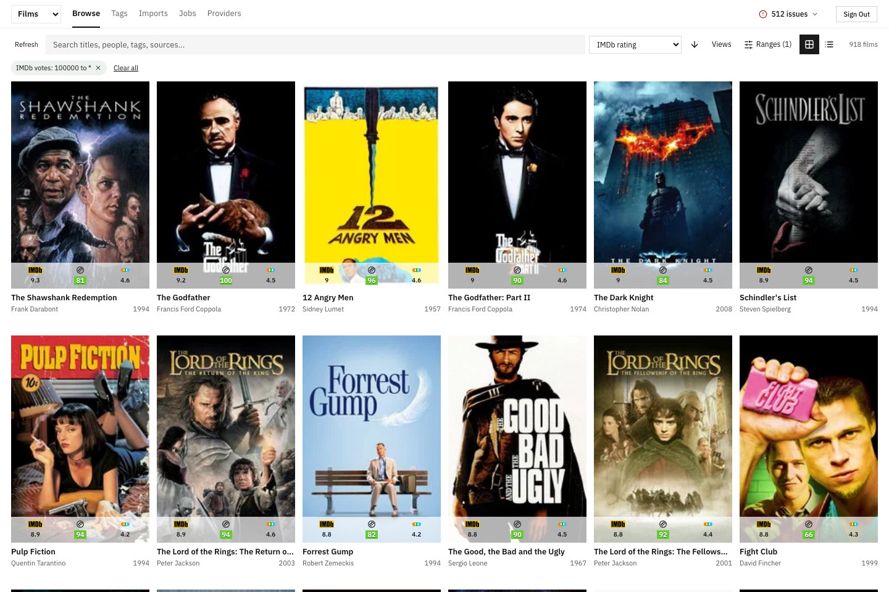
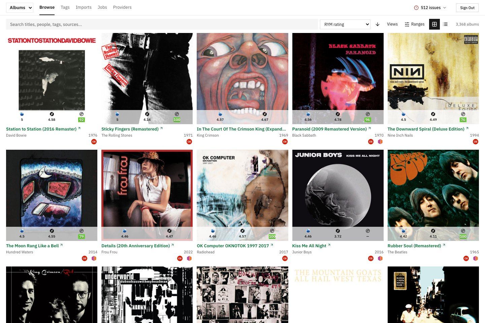
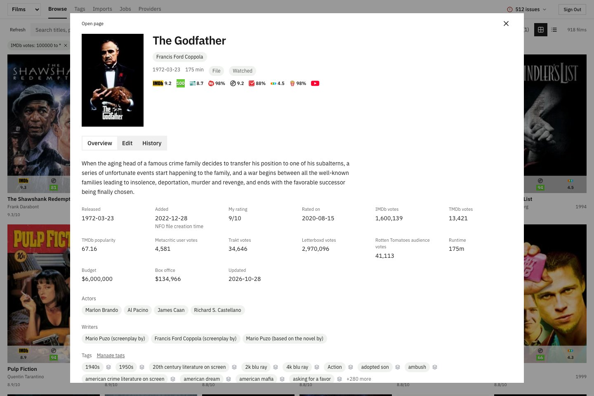
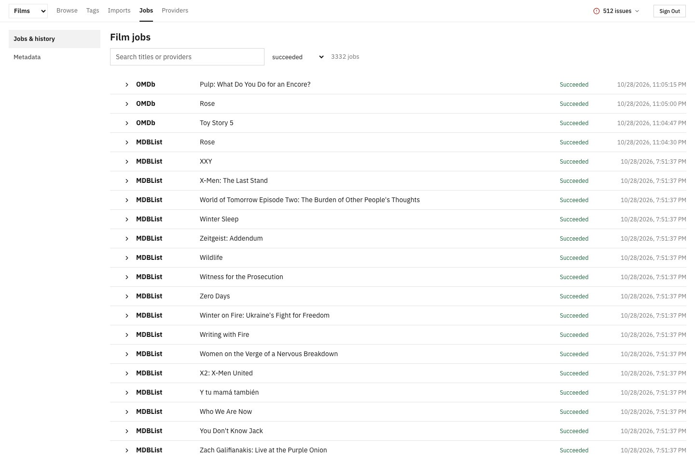
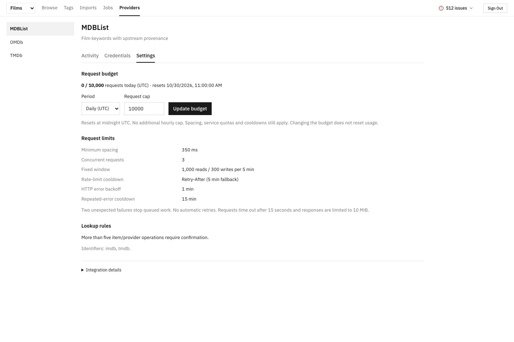

# NFS Media Manager

A personal library for films and albums. Bring in your collection, enrich it with metadata from the providers you choose, and browse it in an artwork grid or a compact table.

This project is a fork of [CSDR Cloud Spatial App](https://github.com/SustainableDevelopmentReform/csdr-cloud-spatial-app), adapted into a personal media library. See [attribution and licenses](NOTICE) for its origins and retained upstream notices.



## What it does

- **Browse your collection.** Search titles, people and tags; filter and sort metadata; switch between grid and table views. Open details without losing your place.
- **Bring your own library.** Preview IMDb ratings/watchlist CSVs, album CSVs and local NFO files before importing. Spotify can import saved albums with your permission.
- **Choose your metadata.** Configure providers independently and fetch only the films or albums you select. Ratings link back to their sources.
- **Keep track of changes.** Inspect provider history, correct identifiers, manage tags and preserve personal ratings and manual edits.
- **Control background work.** Review jobs before starting them, monitor progress, and retry unfinished work. Provider budgets and cooldowns stay in place.

This is a self-hosted app for a personal collection. It runs a Next.js frontend, a Hono API and PostgreSQL. Spotify links open in Spotify; there is no embedded player.

## Getting started

You need **Node.js 22**, **pnpm 9.12** and **PostgreSQL 17**. Docker Compose can supply the local database.

```sh
git clone https://github.com/nf-s/nfs-media-manager.git
cd nfs-media-manager
corepack pnpm install --frozen-lockfile
cp .env.example.local .env
```

Edit `.env`: set `INITIAL_USER_EMAIL`, `INITIAL_USER_NAME` and `INITIAL_USER_PASSWORD`, then replace `BETTER_AUTH_SECRET` and `MEDIA_ENCRYPTION_KEY` with two different random secrets. Generate each one with `openssl rand -hex 32`.

```sh
docker compose -f docker-compose-dev.yml up -d db
corepack pnpm --filter @repo/schemas build
corepack pnpm --filter @repo/media-plugin-sdk build
corepack pnpm --filter @repo/server migrate
corepack pnpm --filter @repo/server seed
corepack pnpm dev
```

Open [localhost:3000](http://localhost:3000) and sign in with the account you configured. Start at **Imports** to add your first films or albums. API keys are optional: you can import files and browse without them.

The [getting started guide](docs/getting-started.md) covers the full setup, environment variables, API-key links, Spotify authorization and troubleshooting. Existing installations should follow the [upgrade and backup notes](docs/getting-started.md#upgrading-and-backing-up) before changing configuration or running migrations.

## Metadata providers

| Library | Providers                                                          |
| ------- | ------------------------------------------------------------------ |
| Films   | TMDb, OMDb, MDBList                                                |
| Albums  | Spotify, MusicBrainz, Last.fm, Discogs, Serply for Rate Your Music |

Choose **Providers → Credentials** to configure a service, **Activity** to inspect requests and **Settings** to see its limits. Only configure the services you want to use. Some services require an account or paid API access. Serply uses indexed search results, so its ratings can lag the source.



## Working with your library

Use the Films/Albums selector to switch libraries. Filters, sorting, visible table columns and grid density are saved separately. **Views** holds grid density and saved album views; **Ranges** narrows numeric and date fields.

Film and album details bring together ratings, credits, tags, provider links and history. Correct metadata in Edit; those overrides survive later imports and refreshes.



**Jobs → Metadata** handles both first-time lookups and refreshes. Select items and providers, review the total, then confirm. In job history, select an action and review it before applying it. Viewing a page never starts a metadata job.





## Documentation

- [Getting started, configuration and troubleshooting](docs/getting-started.md)
- [Import formats and existing-library migration](docs/importing.md)
- [Spotify saved albums and account setup](docs/spotify-album-imports.md)
- [Local provider plugins](docs/local-plugins.md)
- [Development and verification](docs/development.md)
- [All documentation](docs/README.md)

This is an early release. Back up your database before upgrading. Provider availability, quotas and returned fields vary; historical ratings are not guaranteed to be current. Credentials, library exports and local plugins are excluded from Git.

## License

Original NFS Media Manager code is licensed under [MIT](LICENSE). Code adapted from CSDR Cloud Spatial App retains its [Apache 2.0 license and upstream MIT notice](LICENSES/csdr-cloud-spatial-app.txt); see [NOTICE](NOTICE) for attribution. Provider names, marks and media artwork belong to their respective owners. The screenshots show an example personal library; no library data is bundled with the app.
