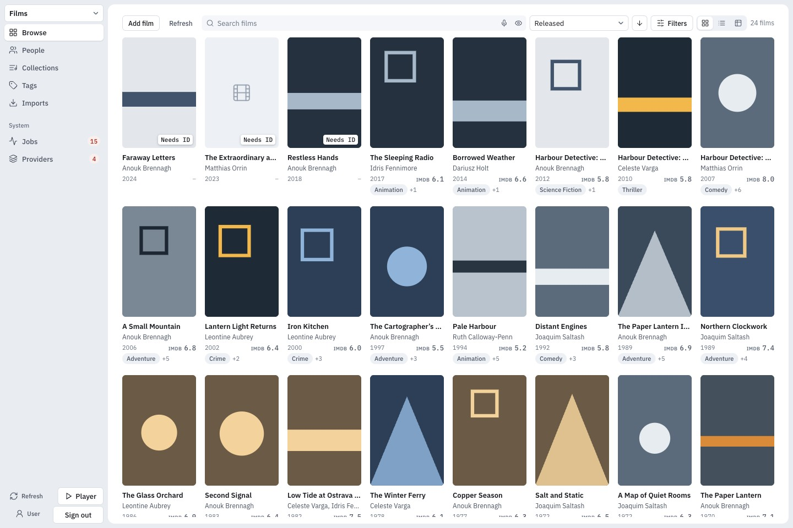
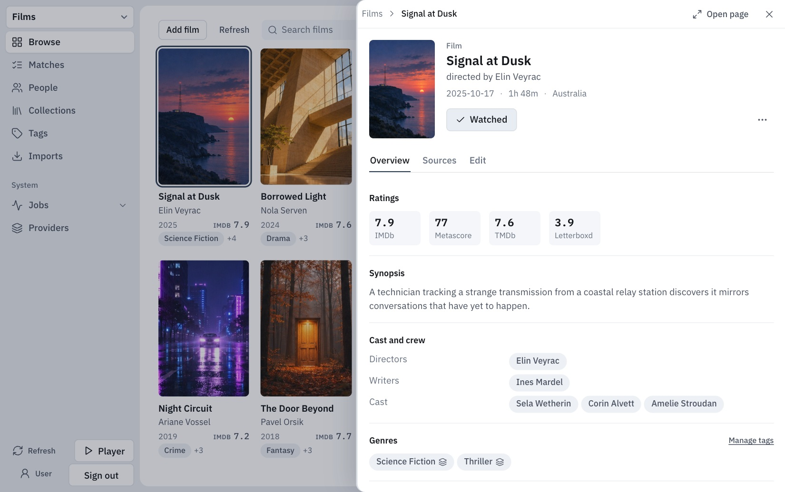
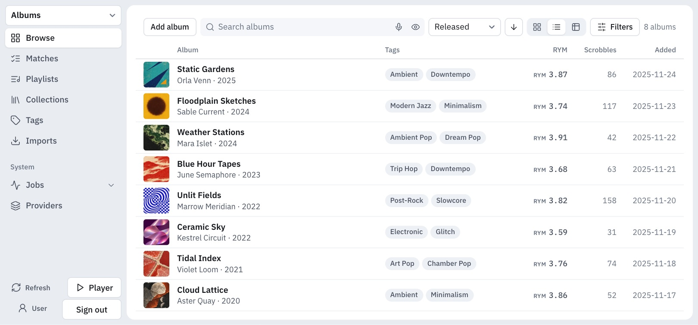

# NFS Media Manager

A self-hosted library for films, albums and tracks. Browse by artwork, follow a credit to the rest of an artist’s work, or filter your collection by genre, release year and rating.

[Set up locally](docs/getting-started.md) · [Import a collection](docs/importing.md) · [Documentation](docs/README.md)

_Screenshots show a demo collection._

## Films

Preview an IMDb watchlist, ratings CSV or folder of NFO files before importing. Open a film to see its cast, compare ratings across sources and mark it as watched without leaving the grid.

See the film inspector

## Music

Import albums from CSV or bring in saved albums, playlists and Liked Songs from Spotify. Open a track to see which albums and playlists include it. Connect Last.fm to browse your listening history alongside your collection.

The library selector also includes [YouTube subscriptions and Spotify podcasts](docs/subscriptions.md) and [radio mixes](docs/mixes.md).

## Running locally

The [setup guide](docs/getting-started.md) walks through starting the app with Node.js 22, pnpm and PostgreSQL 17. Docker Compose can run the database. File imports and browsing work without provider credentials. Connect a metadata provider when you want to look up ratings, artwork or credits.

## License

Original Media Manager code is licensed under [MIT](LICENSE). The project is a fork of CSDR Cloud Spatial App and retains its [Apache 2.0 license and upstream MIT notice](LICENSES/csdr-cloud-spatial-app.txt). See [NOTICE](NOTICE) for attribution.
