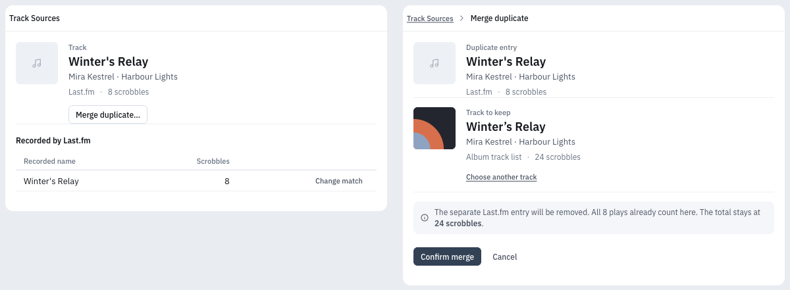
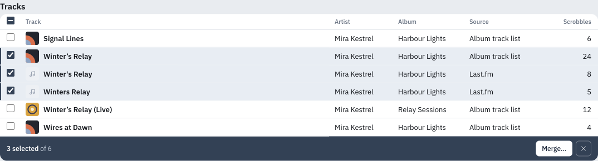
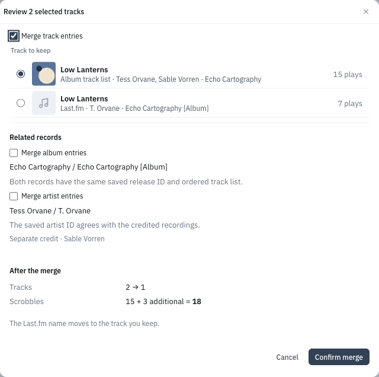

# Library merge handover

The proposed workflow starts where the duplicate is visible. From a track’s **Sources**, choose **Merge duplicate…**. From the **Tracks** table, select two or more entries and choose **Merge…**. Both should answer the same questions before confirmation. Which entry will I keep? Which rows will disappear? What happens to my plays, album positions and artist credits?

The owner liked simplifying Sources and asked for table selection and a review that includes albums and artists. The two interactive prototypes below capture that direction. They use invented records and change only their in-memory examples. The current app supports the pairwise operations below.

A later concept rethinks the model as a whole: a record is made of scrobbled names and Spotify versions, one **Merge** serves tracks, albums and artists, and every change is a history entry with **Undo**. It replaces the two prototypes below if the owner accepts it. [Library merge concept](design-system/concept-library-merge.html)

## Why a linked track can still appear twice

A library track has its own ID. Last.fm stores the artist and title used when a play was recorded. One track owns an imported Last.fm name, while matching can credit plays under that name to several release tracks. Two rows can therefore show the same plays, artwork, artist and album while still having different track IDs. Browse can also group release versions for display. To tell whether entries are duplicates, compare their track IDs, release positions and recording evidence. [Track matching and library behavior](tracks-and-playlists.md) · [Listening history](lastfm-scrobbles.md)

Two diagnostic cases are worth reproducing. An album track can already count a punctuation variant while a standalone Last.fm track still owns that name. Two entries for the same remix can also point to the very same album and artist records. For either case, compare the owning track in `lastfm_track_source` with the credited tracks in `lastfm_track_link`, then inspect the album positions and playlist memberships that retain each row. [Track links](../apps/server/src/services/track-links.ts) · [Database schema](../apps/server/src/schemas/db.ts)

| Current action                                    | What it changes                                                                                                                                                                                                                                                                                                                           |
| ------------------------------------------------- | ----------------------------------------------------------------------------------------------------------------------------------------------------------------------------------------------------------------------------------------------------------------------------------------------------------------------------------------- |
| **Add scrobbled name → Link** or **Change match** | Assigns one recorded artist/title to a chosen track. The first starts at the destination. The second starts at the name. A manual choice persists across syncs and can change which other releases receive those plays.                                                                                                                   |
| **Merge Last.fm names**                           | Moves all names owned by the source to one destination. Album positions and playlist memberships stay with their tracks. A standalone source can disappear if nothing retains it. With one name and no other membership this can look identical to **Link**.                                                                              |
| **Merge with Spotify track**                      | Moves Last.fm names and playlist memberships to one imported or search-confirmed Spotify track. The source must own a Last.fm name and lack an imported Spotify identity. Album positions move only when the source lacks its own Spotify track ID. A Spotify ID obtained solely from an album track list does not qualify a destination. |

A link to an album in track details also differs from occupying a numbered position on that album. Linking a Last.fm album group assigns listening history. Updating an artist profile supplies metadata. Combining two stored albums or two artist IDs would change references throughout the library. [Merge service](../apps/server/src/services/track-merges.ts) · [Track retention](../apps/server/src/services/album-library-tracks.ts) · [Artist records](artists-and-people.md)

## Try the prototypes

From the repository root, run `python3 -m http.server 8080 --bind 127.0.0.1`. Open `http://127.0.0.1:8080/docs/design-system/concept-track-merge.html` for Sources or `http://127.0.0.1:8080/docs/design-system/concept-track-table-merge.html` for the table. The table’s example selector switches between the three cases below. After confirming a merge, **Reset example** restores the sample rows. [Design system viewing instructions](design-system/README.md#viewing-it)

### 1. Start from Track Sources

The page opens with two alternatives side by side. Choose **Track Sources** in either preview to see the entry point. **Merge duplicate…** acts on the track. **Change match** belongs on an individual recorded name so a single mistaken spelling can be moved even when the rest belong here. [Interactive Sources prototype](design-system/concept-track-merge.html)

**Recommended default.** Show a suggestion when saved release and recording evidence identifies one likely destination. Offer **Choose another track** in the review. Start with search when several releases fit. Try both destinations for _Winter’s Relay_. The album track on _Harbour Lights_ already counts all eight plays and stays at 24. The entry on _Relay Singles_ has five different plays and would reach 13. Showing the projected total lets the owner see whether the move adds any listening history.

### 2. Start from the Tracks table

Select individual track rows and choose **Merge…** in the selection bar. The review identifies the track to keep and previews the effect. When it finds separate album or artist records with corroborating evidence, each gets an independent checkbox and a choice of which record to keep. The owner can merge just the albums or artists, or include them with the tracks in one confirmation. [Interactive table prototype](design-system/concept-track-table-merge.html)

| Example                                                                                                    | What to try and what to expect                                                                                                                                                                                                                                                                                                                                                                               |
| ---------------------------------------------------------------------------------------------------------- | ------------------------------------------------------------------------------------------------------------------------------------------------------------------------------------------------------------------------------------------------------------------------------------------------------------------------------------------------------------------------------------------------------------ |
| [Shared album and artist](design-system/concept-track-table-merge.html?example=shared&review=1)            | Review the two spellings of _The Glass Meridian_. They reference the same album ID, artist ID and nine plays. Merging the tracks leaves one row with nine plays. The review marks the album and artist as shared. There is nothing to merge at those levels.                                                                                                                                                 |
| [Separate album and artist entries](design-system/concept-track-table-merge.html?example=related&review=1) | For _Low Lanterns_, the albums share a saved release ID and ordered track list. The artist ID from the provider agrees with the recording credits. Enable each merge and choose the record to keep. The preview counts links moving outside the selection. The featured artist and expanded edition retain their own identities. The two tracks have 15 and seven plays, four in common, giving 18 in total. |
| [Overlapping scrobbles](design-system/concept-track-table-merge.html?example=overlap&review=1)             | Three entries with 24, eight and five plays contain 27 distinct plays. Cancel, add the live recording to the selection and reopen the review. The recording conflict blocks the track merge.                                                                                                                                                                                                                 |

## Implementation handoff

1. **Unify the Sources entry points.** Keep the single-name correction reachable. Start with the existing supported source/destination combinations. Decide whether a stored album position with corroborating recording evidence also qualifies as a destination. The Sources prototype demonstrates that case. The current full-merge endpoint rejects it when the Spotify ID comes only from the album list. [Sources UI](../apps/web/components/track-lastfm-sources.tsx) · [Merge UI](../apps/web/components/track-merge.tsx) · [Current request schemas](../packages/schemas/src/tracks.ts)
2. **Implement a shared server-side preview and apply operation.** Both entry points should send the IDs of the selected records and the ID to keep for each merge. Preview distinct listening events, positions, playlist memberships, all affected credits and which entries will remain. Include changes outside the selection. Revalidate under the existing writer lock, apply the reviewed choices in one transaction and report the actual survivors. A retry or simultaneous import must not partially apply the plan. The existing endpoint accepts one source and target. Repeating it cannot supply an atomic multi-record merge. [Track routes](../apps/server/src/routes/tracks.ts) · [Merge service](../apps/server/src/services/track-merges.ts)
3. **Connect the real Browse table.** Select concrete release tracks. A grouped recording row may reuse a child’s ID. Expanding a group must neither count that ID twice nor silently select hidden releases. After confirmation, update the table, open details and listening totals from the server result. [Track browser](../apps/web/components/track-browser.tsx) · [Release version rows](../apps/web/components/track-recording-versions.tsx)
4. **Extend the review to albums and artists.** Resolve existing internal IDs first. For distinct IDs, show the evidence for each proposed pair and every affected relationship. Preserve provider provenance, manual matches, edition identity, playlist order and dates, disc and track positions, and artist credit roles and order. Define what happens when two records disagree on any of those before enabling that merge. [Database schema](../apps/server/src/schemas/db.ts) · [Synthetic review model](design-system/assets/track-merge-examples.js)

**Decisions still open.** The Sources starting view and suggestion criteria need a final choice. The table lets either track survive and inherit a Spotify link, while the existing full merge always keeps the qualifying Spotify destination. Also decide which evidence warrants an album or artist suggestion, how to handle several plausible pairs, and which conflicts require a narrower selection. The prototypes use predetermined matches and play IDs. Production needs eligibility checks based on stored library and provider evidence.

**Acceptance checks.** Run the three examples above against a disposable database. Verify that cancel writes nothing, stale review data triggers a new preview, and retry or reimport preserves the confirmed names and memberships. Check playlist order, album positions, featured credits and tracks outside the selection before and after each choice. Exercise track-only, album-only, artist-only and combined confirmations, then reopen the surviving entries and check their sources and counts. Test the real table at desktop and phone widths. Existing tests provide starting points for single-name reassignment, pairwise merges and UI refresh. [Scrobble match tests](../apps/server/integration/track-scrobble-match.integration.ts) · [Last.fm track tests](../apps/server/integration/lastfm-tracks.integration.ts) · [Merge UI tests](../apps/web/components/track-merge.test.tsx)
